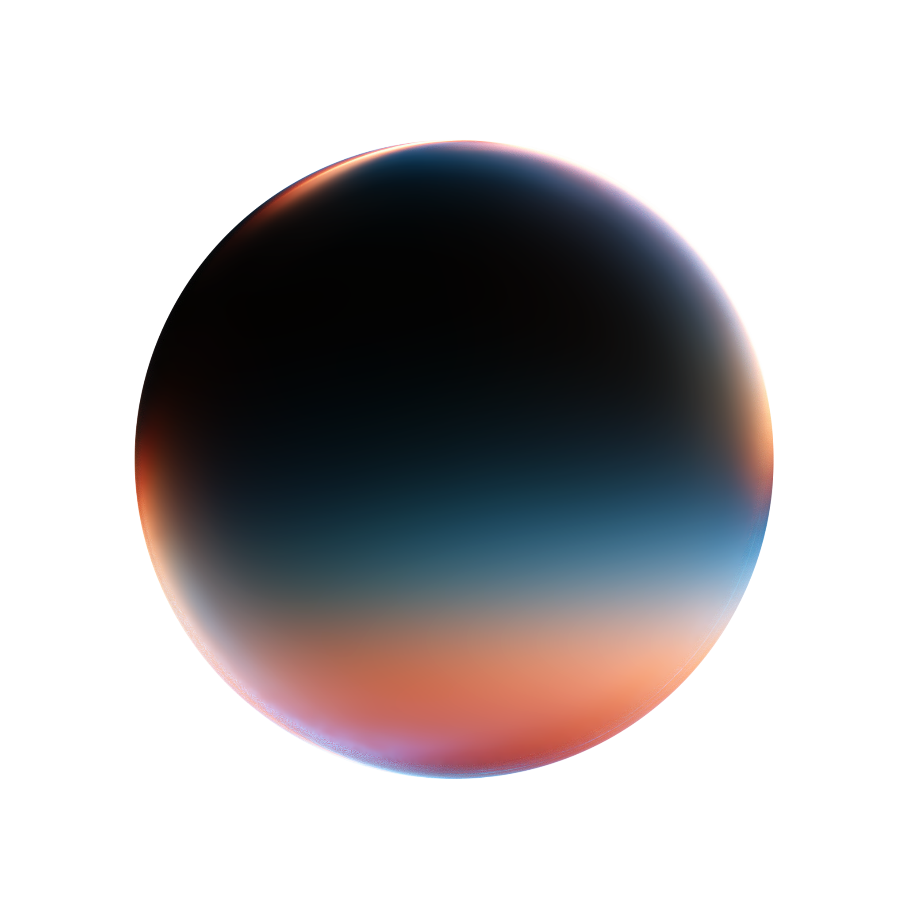

# Penombre

Low-glare VS Code themes: **Ardoise** (dark) and **Papier** (light).

```sh
bun run install-local
```

## Customize

- Colors: `colors/ardoise.css`, `colors/papier.css`
- Where they go: `blueprint/syntax.json` (code), `blueprint/ui.json` (VS Code UI)

Try changes with `bun run watch` and `bun run preview`, install them with `bun run install-local`.
Don't edit `themes/`: it's generated.

Design notes: [docs/AUDIT.md](docs/AUDIT.md).

## Release

Describe each change with `bunx changeset`. Each GitHub release is published to the VS Code
Marketplace by `.github/workflows/publish.yml`.

## License

[MIT](LICENSE.txt). Based on [GitHub Primer](https://primer.style) colors.
